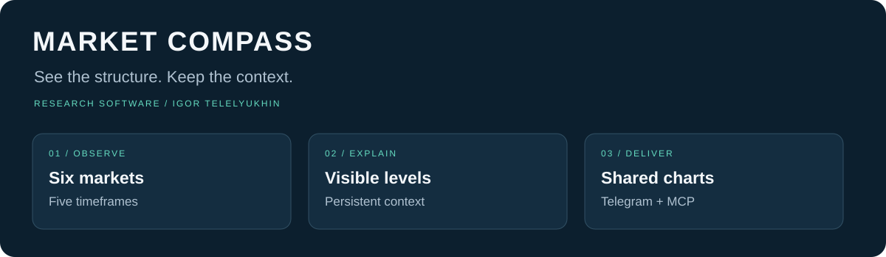
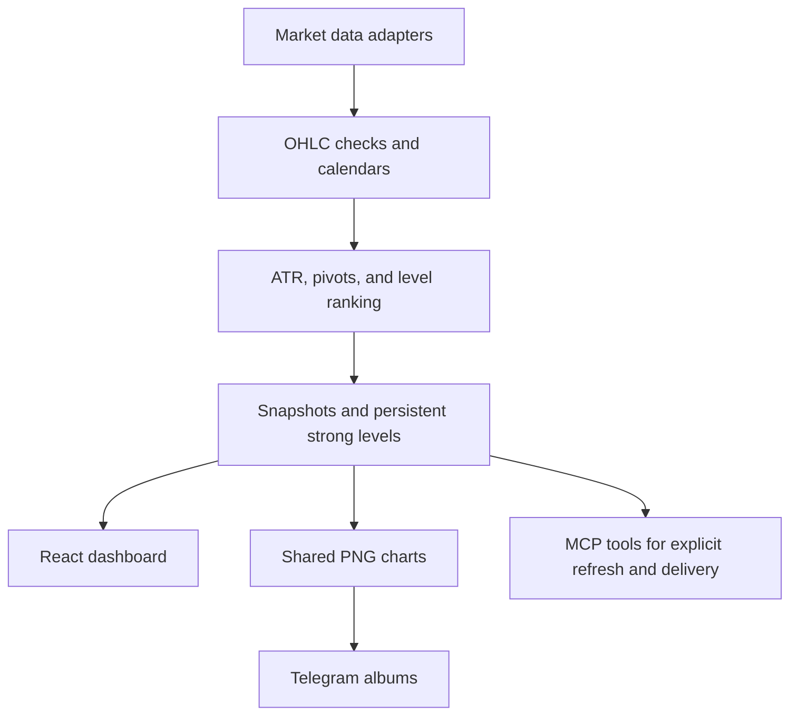

# Market Compass

> Inspect price structure across six markets, preserve important levels, and deliver consistent chart reports to Telegram.



**Cross-timeframe context** · **Persistent price levels** · **Telegram chart reports**

**Status:** `Research prototype · Code available under a non-commercial license · No order execution`

[Overview](#in-30-seconds) · [Architecture](#architecture) · [Setup](docs/SETUP.md) · [Validation](docs/VALIDATION.md) · [Contact](#contact)

**This is not investment advice.** Market Compass is a research dashboard. It observes markets and does not place orders. Level-strength scores are heuristics, not calibrated probabilities, and not evidence of trading profitability.

## In 30 seconds

Market Compass turns scattered market checks into one explainable workflow: inspect price structure across six instruments, see where important levels came from, keep strong levels even when they sit off the visible scale, and deliver the same chart view to Telegram.

Built by **Igor Telelyukhin**, who organizes how people and businesses work with AI where mistakes are expensive. This dashboard is a published research tool. Independent stress testing of trading strategies is a [separate consulting practice](https://github.com/TelelyukhinIgor/TelelyukhinIgor/blob/main/docs/strategy-validation.md).

## For technical due diligence

### Architecture



| Layer | Responsibility |
|---|---|
| Data adapters | Fetch candles from Twelve Data, validate OHLC, reject conflicting timestamps, and apply calendar conventions |
| Analysis | Wilder ATR(14), price pivots, reaction heuristics, tentative extremes, and cross-timeframe level selection |
| Storage | Cloudflare D1 snapshots, settings, reports, and persistent strong levels |
| Interface | React / TypeScript dashboard with session marks, warnings, and source configuration |
| Delivery | Shared PNG chart rendering and Telegram albums |
| Automation | MCP operations that an external scheduler can call explicitly |

The interesting engineering problem was not drawing more lines. It was deciding which lines deserve attention, keeping their provenance, and delivering a consistent view without hiding uncertainty.

A file-level map is in [Architecture](docs/ARCHITECTURE.md).

### What it does

- **One view across six instruments:** gold, EUR/USD, Bitcoin/USD, SPY, QQQ, and USO.
- **Five timeframes, one hierarchy:** W1 → D1 → H4 → H1 → M15, with higher-timeframe context carried into lower-timeframe charts.
- **A readable chart:** up to six annotations, balancing confirmed levels with clearly marked tentative extremes.
- **Persistent strong levels:** hiding a level outside the visible chart does not delete its stored record.
- **Two reporting horizons:** intraday H1 and position D1, with PNG charts delivered as Telegram albums.
- **Visible data limitations:** stale candles, missing history, instrument differences, and calendar assumptions remain visible.
- **An agent interface:** MCP tools expose saved overviews, explicit refreshes, and report delivery.

SPY, QQQ, and USO are funds with their own prices. Their levels are not silently treated as levels for SPX, Nasdaq futures, or spot oil.

### Quick start

This is a **server-backed application**, not a static GitHub Pages website. The code retains its ChatGPT Sites / Cloudflare Workers integration, including D1 and verified identity headers.

Requirements:

- Node.js **22.13 or later** and **pnpm 11.25.0**.
- A compatible Sites development environment, or an adapted Cloudflare deployment with a trusted authentication layer.
- A fresh D1 database and application-owned credentials if live data or Telegram delivery is required.

```bash
git clone https://github.com/TelelyukhinIgor/market-compass.git
cd market-compass
pnpm install --frozen-lockfile
cp .env.example .env.local
pnpm check
pnpm dev
```

Local preview uses port **5173**. Before enabling writes, set the owner identity, initialize the database schema, and configure a 64-character hexadecimal encryption key. See [Setup](docs/SETUP.md).

**The checked-in hosting ID is a placeholder.** Register your own deployment and bind its own database.

### Demo data and integrations

The bundled chart seed is **synthetic**. It exists to demonstrate rendering and must not be interpreted as historical gold prices.

Live data needs a user-supplied Twelve Data key and explicit symbol mappings. Telegram needs a user-supplied bot token and selected chat. Provider access and quotas depend on the user's account. Source defaults are blank and no external schedule is shipped.

### Limits of applicability

- Out-of-sample usefulness of the level ranking has not been established.
- No observation rule has been shown to remain useful after trading costs.
- Holiday and shortened-session handling is incomplete.
- Exact alignment with any particular broker's CFD candles is not claimed.
- Deployment on an arbitrary host requires adapting the Sites identity and storage integration.
- The authentication boundary must strip untrusted identity headers and supply verified identity. Do not expose the worker with spoofable client-supplied headers.

See [Validation and limits](docs/VALIDATION.md) for the checks run on this copy.

### What is intentionally not included

- Production credentials, API keys, Telegram chats, or recipient addresses
- Historical provider datasets
- Performance figures, backtests, or claims of trading edge

### Project status

Market Compass was built and deployed as a working research prototype: data ingestion, charting, persistent levels, and the Telegram workflow are implemented. This repository is a public showcase copy of that work, with portable configuration and synthetic demo data. It is not a hosted service.

On a Linux publication host, `pnpm install --frozen-lockfile`, the TypeScript check (`pnpm check`), and a production `pnpm build` completed successfully. Live data refresh, Telegram delivery, and a new deployment were not run.

### Disclaimer

This software is a research tool for inspecting price structure and delivering charts. It is **not investment advice**, not a signal service, and not a system for placing orders. Use of the code, charts, or reports is at your own risk.

### License

Original application code and documentation are under the [PolyForm Noncommercial License 1.0.0](LICENSE). Third-party components keep their own notices; see [THIRD_PARTY.md](THIRD_PARTY.md) and [NOTICE](NOTICE). Commercial use requires a separate license from the author.

### Contact

If you need an independent review of a trading process or strategy — especially where tail risk, grid or martingale structures, or overfitting are a concern — or if you want this research workflow adapted to your own desk:

- Email: [telelyhina@icloud.com](mailto:telelyhina@icloud.com)
- LinkedIn: [Igor Telelyukhin](https://www.linkedin.com/in/igor-telelyukhin/)

This repository is a public showcase copy with portable configuration and synthetic demo data. It is not a hosted service. Credentials, live databases, recipient lists, and schedules are not included, and publishing the source does not create a running deployment.
